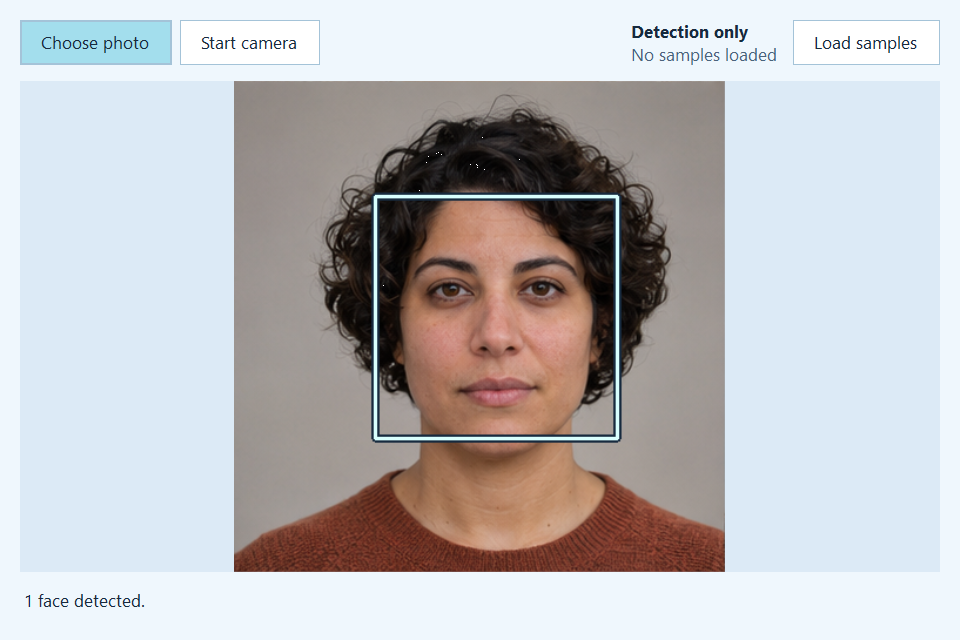
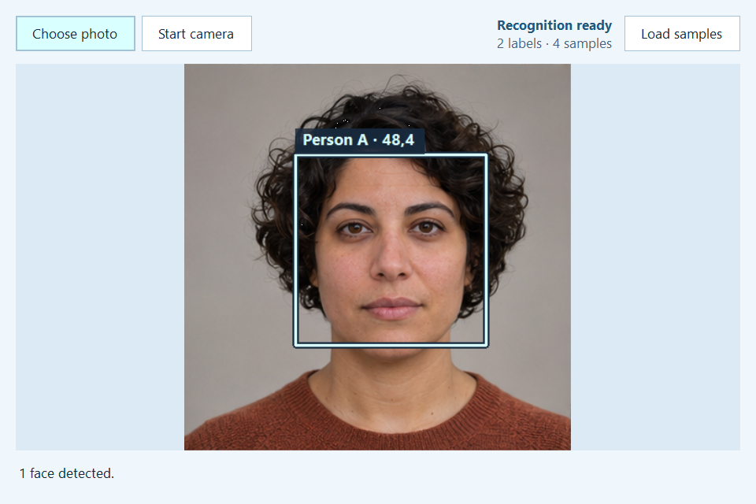

# FaceRecognition

FaceRecognition is a C# Windows Forms application for detecting and recognizing faces in photos and live camera feeds. OpenCV processes images locally.

## Features

- **Photo detection** outlines detected faces and reports how many were found.
- **Live camera preview** uses the default camera and updates the face boxes and count as frames arrive.
- **Local recognition** learns from labeled sample folders and shows a predicted label and match distance next to each face in either input mode.

## Requirements

- Windows x64 and the .NET 10 SDK.
- An available camera with Windows camera access enabled for live preview.

The project uses [OpenCvSharp5.Windows 5.1.0.20261115](https://www.nuget.org/packages/OpenCvSharp5.Windows/5.1.0.20261115), which provides the C# bindings and Windows native runtime. The bundled [OpenCV Haar cascade](https://github.com/opencv/opencv/blob/4.13.0/data/haarcascades/haarcascade_frontalface_default.xml) is copied to the build output. Recognition uses OpenCV's LBPH face recognizer.

## Run from source

From the repository root, run:

```powershell
dotnet run --project src/FaceRecognition/FaceRecognition.csproj
```

## Use the app

1. Select **Choose photo** to open an image, or **Start camera** for live detection. Select **Stop camera** to end the live session.
2. To enable recognition, stop the camera if it is running and select **Load samples**. Choose a local folder with at least two label subfolders. Each label needs at least one readable photo containing exactly one detected face. Use distinct photos for training and testing.
3. When **Recognition ready** appears, open a test photo or restart the camera. The label beside each face shows the closest match and its distance. A lower distance means a closer match. A distance above the matching threshold produces **Unknown**.

An example sample folder looks like this:

```text
samples/
|-- Person A/
|   |-- front.jpg
|   `-- side-light.jpg
`-- Person B/
    |-- front.jpg
    `-- side-light.jpg
```

Supported sample extensions are `.jpg`, `.jpeg`, `.png`, `.bmp`, and `.webp`. The app skips unreadable, face-free, and multi-face samples. Keep your sample folder outside the repository. The trained model lives in memory until the app closes. Photos and camera frames are processed locally.

## Screenshots

### Photo detection



### Local recognition



Both screenshots use a synthetic portrait. The training and test images stay outside the repository.

## Project structure

- `src/FaceRecognition/` contains the WinForms app, layout, and camera and sample controls.
- `src/FaceRecognition/Imaging/` contains photo processing, camera capture, face detection, and local recognition.
- `src/FaceRecognition/Models/` contains the bundled Haar cascade.

## Limitations

- The Haar detector works best with clear, front-facing faces. Small, partly covered, or angled faces may be missed, and other image details can produce false detections.
- Recognition quality depends on the sample set, lighting, and pose. The LBPH distance is a comparison score. It has no percentage scale.
- Live preview uses the default camera. If it fails to open, check Windows camera permissions and close other apps that are using the camera.
